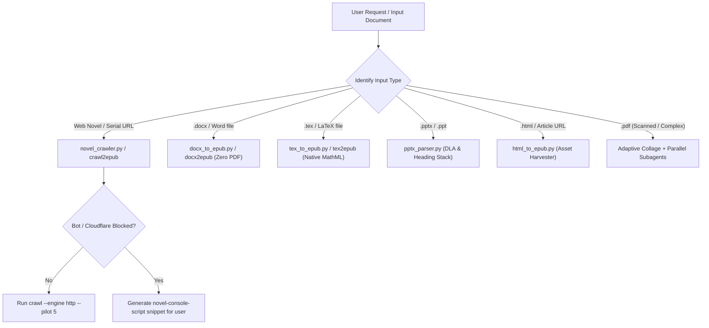

# PDF-to-EPUB: Multi-Format Ebook, Web Novel & Markdown Suite

[](https://opensource.org/licenses/MIT)
[](https://www.python.org/downloads/)
[](https://www.w3.org/publishing/epub3/)
[](https://www.w3.org/Math/)

A universal, high-fidelity conversion engine and agent skill that transforms **PDFs, Word documents (DOCX), LaTeX (TeX), PowerPoint presentations (PPTX/PPT), Web Pages (HTML), and Web Novels** into clean, publication-grade **EPUB3** ebooks and **Markdown**.

---

## Table of Contents

- [Supported Input Formats](#supported-input-formats)
- [Installation Guide](#installation-guide)
  - [One-Command Quick Install](#1-one-command-quick-install)
  - [Manual System Prerequisites](#2-manual-system-prerequisites)
  - [Python Virtual Environment](#3-python-environment)
- [Command Cheatsheet by Format](#command-cheatsheet-by-format)
  - [Web Novels & Serialized Fiction](#1-web-novels--serialized-fiction)
  - [Word Documents (DOCX / ODT)](#2-word-documents-docx--odt)
  - [LaTeX / TeX Documents](#3-latex--tex-documents)
  - [PowerPoint Presentations (PPTX / PPT)](#4-powerpoint-presentations-pptx--ppt)
  - [HTML & Online Articles](#5-html--online-articles)
  - [Complex PDFs (Vision-First Probing)](#6-complex-pdfs-vision-first-probing)
  - [Universal Auto-Detect Converter](#7-universal-auto-detect-converter)
- [DevTools Browser Exporter (Bypass Cloudflare / Paywalls)](#devtools-browser-exporter-bypass-cloudflare--paywalls)
- [Guidelines for LLMs & Autonomous Agents](#guidelines-for-llms--autonomous-agents)
  - [Agent Decision Matrix](#agent-decision-matrix)
  - [Subagent Block Partitioning](#subagent-block-partitioning)
  - [Math & Equation Rule](#math--equation-rule)
  - [Ad Stripping & Boundary Policy](#ad-stripping--boundary-policy)
- [Verification & Quality Assurance](#verification--quality-assurance)
- [Repository Structure](#repository-structure)
- [License](#license)

---

## Supported Input Formats

| Input Format | Engine | Key Highlights | Target Outputs |
|---|---|---|---|
| **Web Novels** (`http://`, `https://`) | `novel_crawler.py` | No-LLM DOM density scoring, multi-tier ad stripping, polite jitter, resumable `.novel_cache/` | `.epub`, `.html` |
| **Word DOCX** (`.docx`, `.odt`, `.rtf`) | `docx_to_epub.py` | Direct conversion (zero intermediate PDF), system font bloat purge, Google Docs gold layout | `.epub`, `.pdf` |
| **LaTeX / TeX** (`.tex`) | `tex_to_epub.py` | Native W3C MathML equations, vector figure transcoding, auto-preamble injection | `.epub` |
| **PowerPoint** (`.pptx`, `.ppt`) | `pptx_parser.py` | Document Layout Analysis (DLA), heading stack state machine, margin footer purging | `.epub`, `.md` |
| **HTML & Web** (`.html`, `.xhtml`, URL) | `html_to_epub.py` | Asset harvesting, base64 PNG decoding, MathML preservation, article ad cleaner | `.epub` |
| **Complex PDF** (`.pdf`) | `collage_maker.py` + Workers | Adaptive visual collage probing (3x3 / 2x2 / 1x1), parallel subagent dispatch, bbox cropper | `.epub`, `.md` |
| **Console ZIP** (`.zip`) | `novel_crawler.py import-zip` | Turn browser DevTools console chapter exports into unified EPUB3 | `.epub` |

---

## Installation Guide

### 1. One-Command Quick Install
```bash
git clone https://github.com/tasmirz/pdf2epub.git
cd pdf2epub
chmod +x install.sh
./install.sh
```

The installer verifies system packages, installs Python dependencies, links `pdf-to-epub` into `~/.local/bin`, and synchronizes the global Antigravity skill directory.

---

### 2. Manual System Prerequisites

Depending on the formats you intend to convert, install the relevant system utilities:

#### Linux (Debian / Ubuntu / Pop!_OS)
```bash
# Core PDF rendering & font support:
sudo apt-get update && sudo apt-get install -y poppler-utils tesseract-ocr

# Optional: For DOCX direct rendering to PDF/EPUB:
sudo apt-get install -y libreoffice-core

# Optional: For LaTeX native compilation:
sudo apt-get install -y texlive-extra-utils tex4ebook make4ht
```

#### Linux (Arch / Manjaro)
```bash
sudo pacman -S --needed poppler tesseract libreoffice-fresh texlive-bin
```

#### macOS (Homebrew)
```bash
brew install poppler tesseract libreoffice
```

---

### 3. Python Environment
```bash
# Recommended: Create a virtual environment
python3 -m venv .venv
source .venv/bin/activate

# Install requirements
pip install -r requirements.txt
```

*(Optional: For headless JavaScript browser rendering on SPA novel sites)*:
```bash
pip install playwright
playwright install chromium
```

---

## Command Cheatsheet by Format

All tools can be invoked via the standalone scripts in `scripts/` or the unified `pdf-to-epub` / `python3 scripts/cli.py` entrypoint.

### 1. Web Novels & Serialized Fiction

```bash
# 1. Probe site structure (detects chapter links, content container, ad blocks)
pdf-to-epub novel-probe https://novel-site.com/book/toc

# 2. Pilot crawl (verify first 5 chapters before committing to full download)
pdf-to-epub crawl2epub https://novel-site.com/book/toc --pilot 5 -o sample.epub

# 3. Full crawl with polite delay (HTTP client - fast & lightweight)
pdf-to-epub crawl2epub https://novel-site.com/book/toc --engine http --delay 1.2 -o novel.epub

# 4. Headless browser crawl (for heavy React / Vue / JS sites)
pdf-to-epub crawl2epub https://novel-site.com/book/toc --engine playwright -o novel.epub

# 5. Audit cached novel chapters
python3 scripts/novel_crawler.py verify https://novel-site.com/book/toc
```

---

### 2. Word Documents (DOCX / ODT)

```bash
# Direct DOCX to EPUB3 (No PDF in between! Google Docs layout match)
pdf-to-epub docx2epub document.docx -o book.epub

# Convert with chapter splitting by heading (H1)
pdf-to-epub docx2epub document.docx -o book.epub --flow split

# Direct DOCX to vector PDF
pdf-to-epub docx2pdf document.docx -o document.pdf --preview
```

---

### 3. LaTeX / TeX Documents

```bash
# Convert TeX directly to EPUB3 with native W3C MathML formulas
pdf-to-epub tex2epub paper.tex -o paper.epub

# Convert raw snippet or lecture notes (auto-injects amsmath/amssymb preambles)
pdf-to-epub tex2epub snippet.tex -o snippet.epub --flow single
```

---

### 4. PowerPoint Presentations (PPTX / PPT)

```bash
# Convert slides into structured EPUB3 textbook using Heading Stack & DLA
pdf-to-epub pptx lecture_slides.pptx -o lecture.epub \
    --title "Neural Networks" \
    --author "Prof. Smith"

# Extract to clean Markdown with purged headers/footers and figure assets
pdf-to-epub pptx lecture_slides.pptx -o lecture.md --figures figures/
```

---

### 5. HTML & Online Articles

```bash
# Convert an HTML file to EPUB3
pdf-to-epub html2epub article.html -o article.epub

# Clean web cruft (strips ads, trackers, sidebars, cookie notices)
pdf-to-epub html2epub article.html -o article.epub --clean-article

# Convert directly from a web URL
pdf-to-epub html2epub https://example.com/deep-dive -o deep_dive.epub

# Merge multiple documentation files into a unified multi-chapter book
pdf-to-epub html2epub ch1.html ch2.html ch3.html -o docs.epub --title "User Manual"
```

---

### 6. Complex PDFs (Vision-First Probing)

```bash
# 1. Inspect page count
pdf-to-epub count paper.pdf

# 2. Render adaptive resolution probes (3x3, 2x2, 1x1)
pdf-to-epub probe paper.pdf -o ./probe_output/

# 3. Render 3x3 visual collage grid
pdf-to-epub collage paper.pdf --start 1 --end 9 --grid 3x3 -o collage.png --dpi 120

# 4. Crop diagram or equation bounding box [ymin, xmin, ymax, xmax] (0–1000 normalized)
pdf-to-epub crop paper.pdf --page 2 --coords "180,120,440,880" -o figures/diagram.png --dpi 300

# 5. Compile Markdown and figures into EPUB3
pdf-to-epub package document.md -o book.epub --figures figures/ --title "Research Paper"
```

---

### 7. Universal Auto-Detect Converter

The `convert` command auto-routes any file or URL based on its extension or scheme:

```bash
pdf-to-epub convert input.docx -o output.epub
pdf-to-epub convert input.tex  -o output.epub
pdf-to-epub convert input.html -o output.epub
pdf-to-epub convert input.pptx -o output.epub
pdf-to-epub convert https://example.com/article -o output.epub
pdf-to-epub convert downloaded_novel.zip -o novel.epub
```

---

## DevTools Browser Exporter (Bypass Cloudflare / Paywalls)

When a web novel site is protected by Cloudflare Turnstile, CAPTCHAs, or requires an authenticated user session:

1. **Generate the custom console script**:
   ```bash
   pdf-to-epub novel-console-script https://site.com/novel/ch1
   ```
2. **Open the browser**:
   - Navigate to Chapter 1 in Chrome/Firefox/Edge while logged in.
   - Open Developer Tools (`F12` or `Ctrl+Shift+I` / `Cmd+Option+I`) and switch to the **Console** tab.
   - Paste the generated snippet and press **Enter**.
3. **What happens**:
   - The script runs directly within your trusted session.
   - It iterates through chapters, cleans inline ad tags, and packages them using `JSZip`.
   - Once finished, it automatically triggers a browser download: `<novel_title>_chapters.zip`.
4. **Convert to EPUB3**:
   ```bash
   pdf-to-epub convert novel_chapters.zip -o novel.epub
   ```

---

## Guidelines for LLMs & Autonomous Agents

If you are an AI assistant (Antigravity, Claude, ChatGPT, Gemini) operating on a user request, adhere to these architectural rules:

### Agent Decision Matrix



### 1. Always Ask Before Choosing Crawler Engine
- Offer the user a clear choice:
  - `[1] HTTP Client`: Fast, lightweight, zero overhead (recommended default).
  - `[2] Playwright`: For heavy JavaScript SPAs.
  - `[3] DevTools Script`: If Cloudflare, bot protections, or login walls block terminal requests.

### 2. Math & Equation Rule
- **Never rasterize simple mathematical formulas**: Convert equations into LaTeX expressions (`$...$` for inline, `$$...$$` for block display). The packager transforms them into standard W3C MathML tags `<math>...</math>`.
- **Reserve visual crops for visual content only**: Crop geometric sketches, circuit schematics, system architecture diagrams, and loss curve plots via `collage_maker.py crop`.

### 3. Subagent Block Partitioning (Large PDFs)
- For PDF documents longer than 12 pages:
  1. Inspect the total page count with `pdf-to-epub count doc.pdf`.
  2. Partition into contiguous 4–8 page blocks.
  3. Spawn parallel worker subagents via `invoke_subagent`.
  4. Each worker returns Markdown and figure references for its block.
  5. The parent agent stitches cross-page sentence splits and compiles the EPUB using `epub_packager.py`.

### 4. Zero Intermediate PDF for DOCX & TeX
- **Never convert DOCX or TeX to PDF first** before generating an EPUB.
- Using PDF as an intermediate format strips semantic tags, fragments paragraphs, and converts native text formulas into fragile bitmaps. Always call `docx_to_epub.py` and `tex_to_epub.py` directly.

---

## Verification & Quality Assurance

After generating an EPUB from a PDF, run the automated sentence-alignment fidelity check:

```bash
pdf-to-epub verify --pdf original.pdf --epub generated.epub --threshold 95.0
```

- **Pass Criterion**: Overall sentence coverage $\ge 95\%$.
- Identifies missing paragraphs, dropped footnotes, and hallucinated sections.
- For web novels, run `novel_crawler.py verify <url_or_slug>` to inspect chapter word-count distributions and catch blank chapter traps.

---

## Repository Structure

```text
pdf2epub/
├── install.sh                  # Universal 1-command installer
├── requirements.txt            # Python dependencies
├── SKILL.md                    # Antigravity skill definition & instructions
├── README.md                   # Complete documentation & user guide
├── scripts/
│   ├── cli.py                  # Unified CLI executable (pdf-to-epub)
│   ├── novel_crawler.py        # Web novel crawler, ad sanitizer & console script
│   ├── docx_to_epub.py         # Direct DOCX to EPUB3 converter (Zero PDF)
│   ├── docx_to_pdf.py          # Direct DOCX to vector PDF converter
│   ├── tex_to_epub.py          # Direct LaTeX to EPUB3 (Native MathML)
│   ├── html_to_epub.py         # HTML / Web article to EPUB3 converter
│   ├── pptx_parser.py          # PowerPoint to EPUB3 & Markdown with DLA
│   ├── collage_maker.py        # Visual grid collage (3x3, 2x2, 1x1) & bbox cropper
│   ├── epub_packager.py        # Zero-dependency standalone EPUB3 packager
│   ├── dla_analyzer.py         # Document layout analysis & shape classification
│   ├── verify_fidelity.py      # Line-by-line quality & sentence coverage verifier
│   └── compare_with_gold.py    # Gold-standard reference comparison benchmark
└── tests/                      # Automated test suite
```

---

## License

Released under the [MIT License](LICENSE).
