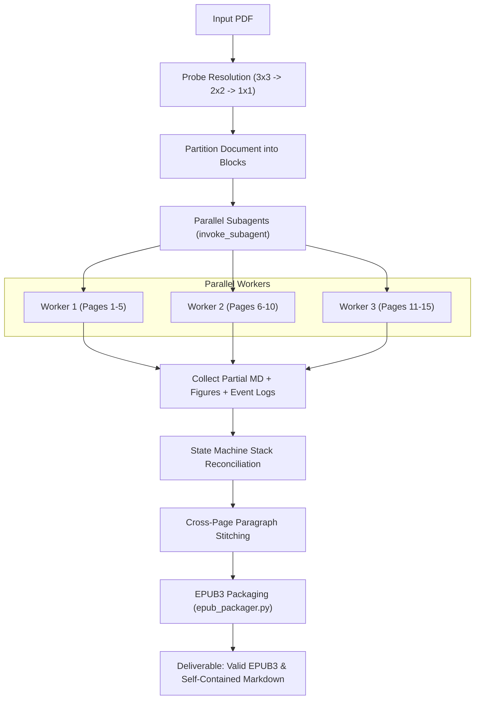

# PDF-to-EPUB: Vision-First Ebook & Markdown Suite

[](https://opensource.org/licenses/MIT)
[](https://www.python.org/downloads/)
[](https://www.w3.org/publishing/epub3/)

A modern, vision-first document conversion suite and Antigravity skill that transforms complex PDFs (academic papers, textbooks, technical manuals, and books) into clean, reflowable **EPUB3** ebooks and **Markdown**.

---

## Key Features

- **Adaptive Visual Grid Probing**: Automatically renders sample pages into 3x3 (9 pages), 2x2 (4 pages), or 1x1 (single page) visual collages to determine the highest density suitable for reading text, formulas, and diagrams.
- **Multimodal LLM / Agent Reasoning**: Layout analysis, column flow determination, and bounding-box coordinates for figure crops are guided directly by vision capabilities.
- **Hierarchical Range Partitioning**: Supports parallel subagent dispatch across page blocks for rapid conversion of large multi-page documents.
- **Hybrid Math Strategy**: Transcribes clean math formulas into native LaTeX (`$...$` and `$$...$$`) for reflowable e-reader typography, with automatic high-resolution visual cropping for complex or ambiguous diagrams.
- **Zero-Dependency EPUB3 Packager**: Packages Markdown, extracted figures, responsive CSS, and navigation manifests (`nav.xhtml`, `toc.ncx`) directly using Python's standard library.
- **Antigravity Skill Ready**: Seamlessly installs into `~/.gemini/config/skills/pdf-to-epub/` for autonomous agent orchestration.

---

## Architecture Overview



---

## Installation

### Automatic Install (Linux / macOS)
```bash
git clone https://github.com/<your-username>/pdf-to-epub.git
cd pdf-to-epub
./install.sh
```

### Manual Install
1. Ensure `poppler-utils` is installed on your system:
   ```bash
   # Debian / Ubuntu:
   sudo apt-get install -y poppler-utils

   # Arch Linux:
   sudo pacman -S poppler

   # macOS:
   brew install poppler
   ```
2. Install Python dependencies:
   ```bash
   pip install -r requirements.txt
   ```
3. (Optional) Install the Antigravity global skill:
   ```bash
   python3 scripts/cli.py install-skill
   ```

---

## CLI Usage

### 1. Count Total Pages
```bash
pdf-to-epub count document.pdf
```

### 2. Adaptive Resolution Probe
Generate 3x3, 2x2, and 1x1 grid samples to inspect document layout:
```bash
pdf-to-epub probe document.pdf -o ./probe_output/
```

### 3. Generate Visual Collage Grid
```bash
# 3x3 Grid (Pages 1-9)
pdf-to-epub collage document.pdf --start 1 --end 9 --grid 3x3 -o collage.png --dpi 120

# 2x2 Grid (Pages 1-4)
pdf-to-epub collage document.pdf --start 1 --end 4 --grid 2x2 -o collage.png --dpi 140
```

### 4. Crop Diagram or Equation
Crop bounding box `[ymin, xmin, ymax, xmax]` (normalized coordinates 0–1000):
```bash
pdf-to-epub crop document.pdf --page 3 --coords "150,200,450,850" -o figures/fig_p3_1.png --dpi 300
```

### 5. Compile EPUB3 Ebook
```bash
pdf-to-epub package document.md \
    -o book.epub \
    --figures figures/ \
    --title "My Book Title" \
    --author "Author Name" \
    --lang en
```

---

## Repository Structure

```
pdf-to-epub/
├── install.sh                  # One-step universal installer
├── requirements.txt            # Minimal Python dependencies
├── SKILL.md                    # Antigravity skill specification
├── scripts/
│   ├── cli.py                  # Unified CLI executable
│   ├── collage_maker.py        # Adaptive grid rendering & bbox cropper
│   └── epub_packager.py        # Standalone EPUB3 compiler
├── tests/
│   ├── run_tests.py            # Automated test runner across PDF types
│   └── samples/                # Sample test documents
├── LICENSE                     # MIT License
└── README.md
```

---

## License

Released under the [MIT License](LICENSE).
