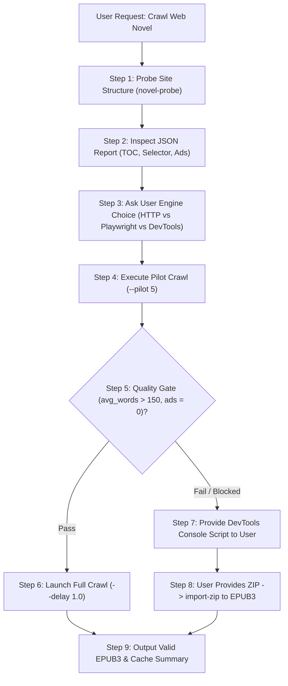

# PDF-to-EPUB: Multi-Format Ebook, Web Novel & Markdown Suite

[](https://opensource.org/licenses/MIT)
[](https://www.python.org/downloads/)
[](https://www.w3.org/publishing/epub3/)
[](https://www.w3.org/Math/)

A universal, high-fidelity document conversion engine and agent skill that transforms **Web Novels, Word documents (DOCX), LaTeX (TeX), PowerPoint presentations (PPTX/PPT), HTML/Web pages, and complex PDFs** into publication-grade **EPUB3** ebooks and **Markdown**.

---

## Quick Navigation

- [Supported Input Formats](#supported-input-formats)
- [Installation Guide (Human & LLM Ready)](#installation-guide-human--llm-ready)
  - [1-Command Universal Install](#1-one-command-quick-install)
  - [LLM Environment Self-Check Protocol](#2-llm-environment-self-check-protocol)
  - [System Package Breakdown](#3-system-prerequisites-by-os)
  - [Python Virtual Environment](#4-python-environment)
- [Command Cheatsheet by Format](#command-cheatsheet-by-format)
  - [Web Novels & Serials](#1-web-novels--serialized-fiction)
  - [Word Documents (DOCX / ODT)](#2-word-documents-docx--odt)
  - [LaTeX / TeX Documents](#3-latex--tex-documents)
  - [PowerPoint Presentations (PPTX / PPT)](#4-powerpoint-presentations-pptx--ppt)
  - [HTML & Online Articles](#5-html--online-articles)
  - [Complex PDFs (Vision-First Probing)](#6-complex-pdfs-vision-first-probing)
  - [Universal Auto-Detect Converter](#7-universal-auto-detect-converter)
- [DevTools Browser Exporter (Bypass Cloudflare / Paywalls)](#devtools-browser-exporter-bypass-cloudflare--paywalls)
- [Full LLM Guidelines: Web Novel Crawler Operational Manual](#full-llm-guidelines-web-novel-crawler-operational-manual)
- [General LLM & Autonomous Agent Principles](#general-llm--autonomous-agent-principles)
- [Repository Structure](#repository-structure)
- [License](#license)

---

## Supported Input Formats

| Input Format | Primary Engine | Key Highlights | Target Outputs |
|---|---|---|---|
| **Web Novels** (`http://`, `https://`) | `novel_crawler.py` | No-LLM DOM density scoring, multi-tier ad stripping, polite delay, DevTools console script, `.novel_cache/` | `.epub`, `.html` |
| **Word DOCX** (`.docx`, `.odt`, `.rtf`) | `docx_to_epub.py` | Direct conversion (zero intermediate PDF), system font bloat purge, Google Docs gold layout match | `.epub`, `.pdf` |
| **LaTeX / TeX** (`.tex`) | `tex_to_epub.py` | Native W3C MathML equations, vector figure transcoding, auto-preamble injection | `.epub` |
| **PowerPoint** (`.pptx`, `.ppt`) | `pptx_parser.py` | Document Layout Analysis (DLA), heading stack state machine, margin footer purging | `.epub`, `.md` |
| **HTML & Web** (`.html`, `.xhtml`, URL) | `html_to_epub.py` | Asset harvesting, base64 PNG decoding, MathML preservation, article ad cleaner (`--clean-article`) | `.epub` |
| **Complex PDF** (`.pdf`) | `collage_maker.py` + Workers | Adaptive visual collage probing (3x3 / 2x2 / 1x1), parallel subagent dispatch, bbox cropper | `.epub`, `.md` |
| **Console ZIP** (`.zip`) | `novel_crawler.py import-zip` | Turn browser DevTools console chapter exports directly into unified EPUB3 | `.epub` |

---

## Installation Guide (Human & LLM Ready)

### 1. One-Command Quick Install
Run this single command on any Linux or macOS system:
```bash
git clone https://github.com/tasmirz/pdf-to-epub.git
cd pdf-to-epub
chmod +x install.sh && ./install.sh
```

**What the installer does automatically:**
1. Checks and installs `poppler-utils` (`pdftoppm`) via your system package manager.
2. Installs required Python packages (`Pillow`, `PyMuPDF`, `latex2mathml`, `python-pptx`, `beautifulsoup4`).
3. Links the unified executable `pdf-to-epub` into `~/.local/bin/`.
4. If Antigravity is detected, synchronizes the skill into `~/.gemini/config/skills/pdf-to-epub/`.

---

### 2. LLM Environment Self-Check Protocol
When an autonomous AI agent or LLM begins work in this repository, run this fast 3-second self-check snippet to determine environment readiness:

```bash
python3 -c "
import sys, shutil
checks = {
    'Python 3.10+': sys.version_info >= (3, 10),
    'bs4': shutil.which('python3') and __import__('importlib.util').util.find_spec('bs4') is not None,
    'pymupdf': __import__('importlib.util').util.find_spec('pymupdf') is not None or __import__('importlib.util').util.find_spec('fitz') is not None,
    'pdftoppm': shutil.which('pdftoppm') is not None,
    'libreoffice': shutil.which('soffice') is not None,
    'tex4ebook': shutil.which('tex4ebook') is not None,
    'playwright': __import__('importlib.util').util.find_spec('playwright') is not None
}
print('=== Toolchain Readiness Audit ===')
for name, ok in checks.items():
    print(f'[{chr(10003) if ok else \" \"}] {name:15}: {\"READY\" if ok else \"MISSING / OPTIONAL\"}')
"
```

If dependencies are missing:
```bash
# Core Python requirements:
pip install -r requirements.txt --break-system-packages

# Optional Playwright browser (for heavy JS SPAs):
pip install playwright && playwright install chromium
```

---

### 3. System Prerequisites by OS

Depending on which formats you plan to convert, install the matching system packages:

#### Debian / Ubuntu / Pop!_OS
```bash
# Core PDF rendering & OCR:
sudo apt-get update && sudo apt-get install -y poppler-utils tesseract-ocr

# For DOCX direct rendering:
sudo apt-get install -y libreoffice-core

# For LaTeX native MathML compilation:
sudo apt-get install -y texlive-extra-utils tex4ebook make4ht
```

#### Arch Linux / Manjaro
```bash
sudo pacman -S --needed poppler tesseract libreoffice-fresh texlive-bin
```

#### macOS (Homebrew)
```bash
brew install poppler tesseract libreoffice
```

---

### 4. Python Environment
```bash
# Setup virtual environment (recommended):
python3 -m venv .venv
source .venv/bin/activate
pip install -r requirements.txt
```

---

## Command Cheatsheet by Format

Use either the unified `pdf-to-epub` CLI command or invoke `scripts/cli.py` directly:

### 1. Web Novels & Serialized Fiction
```bash
# 1. Probe site structure (discovers chapter links, content container, ad blocks)
pdf-to-epub novel-probe https://novel-site.com/book/toc

# 2. Pilot crawl (downloads & verifies first 5 chapters before full crawl)
pdf-to-epub crawl2epub https://novel-site.com/book/toc --pilot 5 -o sample.epub

# 3. Full crawl with polite delay (HTTP client - fast & zero overhead)
pdf-to-epub crawl2epub https://novel-site.com/book/toc --engine http --delay 1.2 -o novel.epub

# 4. Headless browser crawl (for heavy React / Vue / SPA novel sites)
pdf-to-epub crawl2epub https://novel-site.com/book/toc --engine playwright -o novel.epub

# 5. Audit cached novel chapters
python3 scripts/novel_crawler.py verify https://novel-site.com/book/toc
```

---

### 2. Word Documents (DOCX / ODT)
```bash
# Direct DOCX to EPUB3 (Zero intermediate PDF! Google Docs layout match)
pdf-to-epub docx2epub document.docx -o book.epub

# Convert with chapter splitting by heading (H1)
pdf-to-epub docx2epub document.docx -o book.epub --flow split

# Direct DOCX to vector PDF
pdf-to-epub docx2pdf document.docx -o document.pdf --preview
```

---

### 3. LaTeX / TeX Documents
```bash
# Convert TeX directly to EPUB3 with native W3C MathML equations
pdf-to-epub tex2epub paper.tex -o paper.epub

# Convert raw snippet or lecture notes (auto-injects amsmath/amssymb preambles)
pdf-to-epub tex2epub snippet.tex -o snippet.epub --flow single
```

---

### 4. PowerPoint Presentations (PPTX / PPT)
```bash
# Convert slides into structured EPUB3 textbook using Heading Stack & DLA
pdf-to-epub pptx lecture_slides.pptx -o lecture.epub \
    --title "Neural Networks" \
    --author "Prof. Smith"

# Extract to clean Markdown with purged headers/footers and figure assets
pdf-to-epub pptx lecture_slides.pptx -o lecture.md --figures figures/
```

---

### 5. HTML & Online Articles
```bash
# Convert an HTML file to EPUB3
pdf-to-epub html2epub article.html -o article.epub

# Clean web cruft (strips ads, trackers, sidebars, cookie notices)
pdf-to-epub html2epub article.html -o article.epub --clean-article

# Convert directly from an online URL
pdf-to-epub html2epub https://example.com/deep-dive -o deep_dive.epub

# Merge multiple documentation files into a unified multi-chapter book
pdf-to-epub html2epub ch1.html ch2.html ch3.html -o docs.epub --title "User Manual"
```

---

### 6. Complex PDFs (Vision-First Probing)
```bash
# 1. Inspect page count
pdf-to-epub count paper.pdf

# 2. Render adaptive resolution probes (3x3, 2x2, 1x1)
pdf-to-epub probe paper.pdf -o ./probe_output/

# 3. Render 3x3 visual collage grid
pdf-to-epub collage paper.pdf --start 1 --end 9 --grid 3x3 -o collage.png --dpi 120

# 4. Crop diagram or equation bounding box [ymin, xmin, ymax, xmax] (0–1000 normalized)
pdf-to-epub crop paper.pdf --page 2 --coords "180,120,440,880" -o figures/diagram.png --dpi 300

# 5. Compile Markdown and figures into EPUB3
pdf-to-epub package document.md -o book.epub --figures figures/ --title "Research Paper"
```

---

### 7. Universal Auto-Detect Converter
```bash
pdf-to-epub convert input.docx -o output.epub
pdf-to-epub convert input.tex  -o output.epub
pdf-to-epub convert input.html -o output.epub
pdf-to-epub convert input.pptx -o output.epub
pdf-to-epub convert https://example.com/article -o output.epub
pdf-to-epub convert downloaded_novel.zip -o novel.epub
```

---

## DevTools Browser Exporter (Bypass Cloudflare / Paywalls)

When a web novel site blocks automated tools with Cloudflare Turnstile, CAPTCHAs, or requires an authenticated session:

1. **Generate the custom browser script**:
   ```bash
   pdf-to-epub novel-console-script https://site.com/novel/ch1
   ```
2. **Open the browser**:
   - Navigate to Chapter 1 in Chrome/Firefox/Edge while logged in.
   - Press **F12** (or `Ctrl+Shift+I` / `Cmd+Option+I`) and switch to the **Console** tab.
   - Paste the generated snippet and press **Enter**.
3. **What happens**:
   - The script runs directly within your trusted session.
   - It iterates through chapters, cleans inline ad tags, and packages them using `JSZip`.
   - Once finished, it automatically triggers a browser download: `<novel_title>_chapters.zip`.
4. **Convert to EPUB3**:
   ```bash
   pdf-to-epub convert novel_chapters.zip -o novel.epub
   ```

---

## Full LLM Guidelines: Web Novel Crawler Operational Manual

This section defines the mandatory, deterministic protocol that an autonomous AI agent or LLM must follow when a user requests crawling a web novel.



### Step-by-Step Agent Protocol

#### Phase 1: Pre-Flight Probe
Never start crawling hundreds of chapters blindly. First probe the target URL:
```bash
python3 scripts/cli.py novel-probe <URL>
```
Inspect the output JSON:
- `is_toc_page`: If `true`, the URL is an index page containing ordered chapter links.
- `toc_links_found`: Total chapter URLs discovered.
- `detected_content_selector`: The CSS selector of the main story container.
- `has_next_chapter`: If `true`, the site supports sequential next-link traversal.

#### Phase 2: Engine Selection (Always Ask the User First)
Before launching a long background crawl, ask the user their preferred engine:
> "I have probed the site structure. Which crawler engine would you like to use?
> - **[1] HTTP Client (Recommended)**: Fast, lightweight, zero-dependency.
> - **[2] Playwright**: Headless browser for JavaScript/React-heavy sites.
> - **[3] DevTools Console Script**: Generates a JavaScript snippet you can paste into your browser (F12) to bypass Cloudflare or paywalls."

#### Phase 3: Pilot Run (Quality Verification Gate)
Always run a pilot batch of **3 to 5 chapters** first:
```bash
python3 scripts/cli.py crawl2epub <URL> --pilot 5 -o /tmp/pilot.epub
```
Audit the health report output:
- **Average Words per Chapter**: Must be $\ge 150$ words.
- **Suspicious Short Chapters**: If chapters are flagged with $< 50$ words, inspect `.novel_cache/novels/<slug>/clean_html/ch_0001.html`. This indicates an incorrect content selector or a bot protection wall.
- **Ad Cleanliness**: Verify that no ad banners, tracking scripts, or sponsor blocks remain.

#### Phase 4: Full Crawl Execution & Rate Limiting
Once the pilot passes, proceed with the full crawl:
```bash
python3 scripts/cli.py crawl2epub <URL> --engine http --delay 1.2 -o novel.epub
```
- **Polite Delays**: Always maintain a minimum delay of `1.0s` to `2.0s` between requests to prevent IP bans.
- **Resumability**: If the crawl is interrupted, re-running the same command automatically resumes from the last cached chapter in `.novel_cache/novels/<slug>/`.

#### Phase 5: Anti-Bot & Cloudflare Fallback Protocol
If the HTTP client or Playwright receives HTTP 403, 503, or a Cloudflare verification challenge:
1. **Do not loop or retry in vain.**
2. Immediately generate the browser DevTools script:
   ```bash
   python3 scripts/cli.py novel-console-script <URL>
   ```
3. Relay the script to the user with clear instructions:
   > "The site is protected by Cloudflare/anti-bot checks. Please open Chapter 1 in your browser, press **F12**, paste the script below into the **Console**, and press Enter. It will download `<novel_name>_chapters.zip` directly from your browser."
4. Once the user has the zip file, convert it directly:
   ```bash
   python3 scripts/cli.py convert downloaded_chapters.zip -o novel.epub
   ```

---

## General LLM & Autonomous Agent Principles

### 1. Math & Equation Preservation
- **Never rasterize simple mathematical formulas**: Convert equations into standard LaTeX expressions (`$...$` for inline, `$$...$$` for display blocks). The packager transforms them into native W3C MathML (`<math>...</math>`).
- **Reserve visual crops for diagrams only**: Crop geometric sketches, circuit schematics, system architecture figures, and loss curves via `collage_maker.py crop`.

### 2. Zero Intermediate PDF for DOCX & LaTeX
- **Never convert DOCX or TeX to PDF first** before generating an EPUB.
- Intermediate PDFs strip semantic headings, break paragraph continuity, and degrade equations into blurry bitmaps. Always call `docx_to_epub.py` and `tex_to_epub.py` directly.

### 3. Subagent Block Partitioning (Large PDFs)
- For PDF documents longer than 12 pages:
  1. Inspect total page count with `pdf-to-epub count doc.pdf`.
  2. Partition into contiguous 4–8 page blocks.
  3. Spawn parallel worker subagents using `invoke_subagent`.
  4. Each worker processes its block concurrently and returns Markdown with figure references.
  5. The coordinator agent stitches cross-page paragraph cuts and builds the EPUB via `epub_packager.py`.

---

## Repository Structure

```text
pdf2epub/
├── install.sh                  # Universal 1-command installer
├── requirements.txt            # Python dependencies
├── SKILL.md                    # Antigravity skill specification
├── README.md                   # Complete documentation & user guide
├── scripts/
│   ├── cli.py                  # Unified CLI executable (pdf-to-epub)
│   ├── novel_crawler.py        # Web novel crawler, ad sanitizer & console script
│   ├── docx_to_epub.py         # Direct DOCX to EPUB3 converter (Zero PDF)
│   ├── docx_to_pdf.py          # Direct DOCX to vector PDF converter
│   ├── tex_to_epub.py          # Direct LaTeX to EPUB3 (Native MathML)
│   ├── html_to_epub.py         # HTML / Web article to EPUB3 converter
│   ├── pptx_parser.py          # PowerPoint to EPUB3 & Markdown with DLA
│   ├── collage_maker.py        # Visual grid collage (3x3, 2x2, 1x1) & bbox cropper
│   ├── epub_packager.py        # Zero-dependency standalone EPUB3 packager
│   ├── dla_analyzer.py         # Document layout analysis & shape classification
│   ├── build_textbook_edition.py # Pedagogical textbook restructurer
│   ├── verify_fidelity.py      # Line-by-line quality & sentence coverage verifier
│   └── compare_with_gold.py    # Gold-standard reference comparison benchmark
└── tests/                      # Automated test suite
```

---

## License

Released under the [MIT License](LICENSE).
