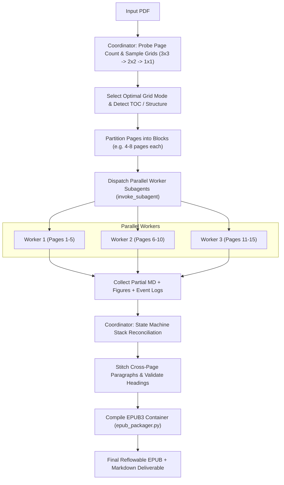

# PDF to EPUB Converter Skill

A vision-first, parallel multi-agent skill for converting complex PDF documents (academic papers, textbooks, manuals, novels) into clean, reflowable **EPUB3** ebooks and **Markdown**.

---

## Core Architecture & Principles

1. **Portable & Repository-Agnostic**: Self-contained within `~/.gemini/config/skills/pdf-to-epub/`. Does not depend on external frameworks or specific repository setups.
2. **Adaptive Visual Grid Sampling (Collage Probing)**:
   - Probes page density starting with **3x3** (9 pages/view) -> **2x2** (4 pages/view) -> **1x1** (single-page high resolution).
   - Determines the highest page density that allows 100% reliable text, diagram, and equation reading.
3. **Hierarchical Range Partitioning with Parallel Subagents**:
   - The **Coordinator Agent** probes resolution, scans the Table of Contents (TOC), partitions the document into balanced page blocks, and dispatches parallel worker subagents using `invoke_subagent`.
   - **Worker Subagents** process their assigned page blocks concurrently using multimodal vision capabilities.
4. **Hybrid Math & Visual Asset Strategy**:
   - **LaTeX-First**: Transcribes clean inline (`$...$`) and display (`$$...$$`) math formulas into LaTeX for reflowable e-reader typography.
   - **Visual Fallback**: Crops high-resolution images (`[ymin, xmin, ymax, xmax]`) for complex chemical diagrams, commutative diagrams, intricate charts, dense figures, and ambiguous handwritten formulas.
5. **Structured Header Event Log & State Machine Stack**:
   - Workers emit Markdown along with structured event tags for headings, container openings/closings, and cross-page paragraph cuts.
   - Coordinator reconciles the global hierarchy stack, stitches split sentences across page boundaries, and generates the EPUB Table of Contents.

---

## Bundled Helper Utilities

The skill bundles standalone Python scripts located at `~/.gemini/config/skills/pdf-to-epub/scripts/`:
- `pptx_parser.py`: Direct PowerPoint (PPTX / PPT) to Markdown & EPUB3 extraction engine with OCR.
- `collage_maker.py`: Adaptive visual grid collage generator and region cropper (supports PDF, PPTX, PPT).
- `epub_packager.py`: Self-contained EPUB3 compiler with native W3C MathML and single/multi-flow layout.
- `verify_fidelity.py`: Line-by-line quality and fidelity verifier with sentence alignment coverage.
- `cli.py`: Unified command-line interface (`pdf-to-epub`).

### 1. `pptx_parser.py` (PowerPoint to EPUB3 & Markdown with DLA)
```bash
# Convert PPTX or legacy PPT directly into reflowable EPUB3 using DLA & Heading Stack
python3 ~/.gemini/config/skills/pdf-to-epub/scripts/pptx_parser.py presentation.pptx \
    -o presentation.epub \
    --title "Course Module Title" \
    --author "Professor Name"

# Extract presentation to Markdown with DLA manifest and purged footers/headers
python3 ~/.gemini/config/skills/pdf-to-epub/scripts/pptx_parser.py presentation.pptx \
    -o presentation.md \
    --figures figures/ \
    --manifest dla_manifest.json
```
- **Document Layout Analysis (DLA)**: Intelligently classifies shapes into text, tables, diagram figures, and equation blocks.
- **Repetitive Header & Footer Purging**: Scans margin regions (top 15%, bottom 15%) across slides and removes repeating institutional text, professor names, course codes, and slide numbers.
- **Heading Stack State Machine**: Groups continuation slides under the same semantic topic (H1 -> H2 -> H3), preventing artificial 1-slide page breaks and creating cohesive textbook chapters.
- **Multimodal Vision Routing**: Routes complex mathematical formulas and text graphics to Vision LLMs for LaTeX MathML transcription, while embedding diagrams/illustrations as-is. Replaces noisy pytesseract OCR.

### 2. `collage_maker.py`
```bash
# 1. Get total page/slide count
python3 ~/.gemini/config/skills/pdf-to-epub/scripts/collage_maker.py count document.pdf

# 2. Render visual collage grid (3x3, 2x2, or 1x1) - works on PDF and PPTX/PPT
python3 ~/.gemini/config/skills/pdf-to-epub/scripts/collage_maker.py collage document.pdf \
    --start 1 --end 9 --grid 3x3 -o /tmp/probe_3x3.png --dpi 120

# 3. Crop figure/equation bounding box from high-res page (coords: ymin,xmin,ymax,xmax in 0-1000 or 0.0-1.0)
python3 ~/.gemini/config/skills/pdf-to-epub/scripts/collage_maker.py crop document.pdf \
    --page 3 --coords "150,200,450,850" -o figures/fig_p3_1.png --dpi 300
```

### 3. `epub_packager.py`
```bash
# Compile Markdown + cropped figures into valid EPUB3
python3 ~/.gemini/config/skills/pdf-to-epub/scripts/epub_packager.py document.md \
    -o book.epub \
    --figures figures/ \
    --title "Document Title" \
    --author "Author Name" \
    --lang en \
    --split-mode auto
```

### 4. `verify_fidelity.py` (Line-by-Line Quality & Fidelity Verifier)
```bash
# Run line-by-line verification after each build (supports PDF, PPTX, and PPT)
python3 ~/.gemini/config/skills/pdf-to-epub/scripts/verify_fidelity.py \
    --source presentation.pptx \
    --epub presentation.epub \
    --threshold 95.0 \
    --verbose
```

---


## End-to-End Execution Protocol



### Stage 1: Document Reconnaissance & Grid Probing

1. **Inspect Page Count**:
   Run `collage_maker.py count <pdf_path>` to determine the total number of pages.
2. **Adaptive Grid Probing**:
   - Render a probe collage of pages 1–4 using `3x3` grid mode to `/tmp/probe_grid.png`.
   - Inspect the image. Evaluate:
     - Are body text fonts crisp and fully legible?
     - Are inline mathematical symbols (`\alpha`, `\sum`, sub/superscripts) unambiguously distinguishable?
     - If text is too small or multi-column layout is dense, test `2x2`.
     - If font is tiny, scanned, or complex, adopt `1x1` single-page rendering.
3. **Detect Table of Contents & Major Divisions**:
   - Check pages 1–5 for an explicit Table of Contents or chapter listing.
   - Note major structural divisions to guide block partitioning.

---

### Stage 2: Page Partitioning & Subagent Dispatch

Partition the PDF into contiguous page chunks. 
- **Standard Books / Novels**: 8–12 pages per chunk.
- **Academic / Math / 2-Column Papers**: 3–5 pages per chunk.

Call `invoke_subagent` to launch parallel workers. Example:
```python
invoke_subagent(
    Subagents=[
        {
            "TypeName": "self",
            "Role": "PDF Worker Batch 1",
            "Prompt": worker_prompt(start=1, end=5, grid="2x2", ...)
        },
        {
            "TypeName": "self",
            "Role": "PDF Worker Batch 2",
            "Prompt": worker_prompt(start=6, end=10, grid="2x2", ...)
        }
    ]
)
```

---

### Stage 3: Worker Subagent Execution Protocol

Each worker follows this strict workflow:

1. **Render Grid Collages for Assigned Range**:
   Run `collage_maker.py collage <pdf_path> --start <S> --end <E> --grid <GRID> -o <chunk_img>`.
2. **Multimodal Analysis & Reading Flow**:
   - Identify multi-column flow (read left column top-to-bottom, then right column).
   - Strip running headers, footers, and floating page numbers.
   - De-hyphenate line-wrapped words (e.g. `distri-` + `buted` -> `distributed`), but preserve real compound words.
3. **Hybrid Math & Figure Extraction**:
   - Standard formulas: write as LaTeX (`$...$` or `$$...$$`).
   - Diagrams, charts, plots, complex architecture diagrams:
     - Determine bounding box `[ymin, xmin, ymax, xmax]` (0–1000 scale).
     - Run `collage_maker.py crop <pdf> --page <P> --coords "<coords>" -o "figures/fig_p<P>_<N>.png"`.
     - Insert markdown reference: ``.
4. **Structured Event Logging**:
   At the beginning or end of its generated Markdown, the worker records its structural events in a JSON metadata block:
   ```json
   ```events
   [
     {"type": "heading", "level": 1, "title": "1. Introduction", "page": 1},
     {"type": "heading", "level": 2, "title": "1.1 Background", "page": 2},
     {"type": "split_out", "ends_with_open_sentence": true, "last_words": "resulting in higher throughput"}
   ]
   ```
   ```

---

### Stage 4: Coordinator Hierarchy Stack & Assembly

The Coordinator receives completed outputs from all subagents and reconciles them:

1. **State-Machine Hierarchy Stack**:
   - Maintain a stack of active heading levels: `[H1, H2, ...]`.
   - If a worker outputs an `H3` under an `H1` without an `H2`, normalize or nest appropriately.
   - Build a clean Table of Contents tree.
2. **Seamless Cross-Page Paragraph Stitching**:
   - If Worker `N` ended with `ends_with_open_sentence: true` and Worker `N+1` began without a heading or indent, concatenate the paragraphs without an artificial line break.
3. **Consolidate Figures**:
   - Verify that all referenced `figures/*.png` files exist on disk.
4. **Write Unified Markdown**:
   - Assemble the unified document into `output.md`.

---

### Stage 5: EPUB3 Packaging & Verification

1. **Compile EPUB**:
   Run the packager script:
   ```bash
   python3 ~/.gemini/config/skills/pdf-to-epub/scripts/epub_packager.py output.md \
       -o output.epub \
       --figures figures/ \
       --title "<Book Title>" \
       --author "<Author Name>"
   ```
2. **Quality & Structure Validation**:
   - Check that `mimetype` is uncompressed at offset 0 (`unzip -l output.epub`).
   - Verify `EPUB/nav.xhtml` contains all detected chapters.
   - Check that figures and math equations are cleanly formatted.

---

## Detailed Worker Prompt Template

When invoking subagents, format their prompt using this template:

```markdown
You are a PDF-to-EPUB conversion worker responsible for Pages {START} to {END} of {PDF_PATH}.

### Tasks:
1. Render your pages using the agreed grid resolution:
   python3 ~/.gemini/config/skills/pdf-to-epub/scripts/collage_maker.py collage "{PDF_PATH}" --start {START} --end {END} --grid {GRID} -o "/tmp/batch_{START}_{END}.png" --dpi 140

2. View the generated collage image. Read all text in natural reading order (handle multi-column layout properly).
   - Strip headers, footers, and page numbers.
   - Format standard formulas as LaTeX: $...$ for inline, $$...$$ for display blocks.
   - For all figures, plots, diagrams, or dense equations, crop them using:
     python3 ~/.gemini/config/skills/pdf-to-epub/scripts/collage_maker.py crop "{PDF_PATH}" --page <P> --coords "ymin,xmin,ymax,xmax" -o "figures/fig_p<P>_<N>.png"
     And reference them as: 

3. Format tables using clean Markdown table syntax (| Col 1 | Col 2 |).

4. Save your section's Markdown to: "/tmp/section_{START}_{END}.md"
   Include your structural event log at the very end in a ```events ... ``` block:
   [
     {"type": "heading", "level": <1-6>, "title": "<Heading Title>", "page": <P>},
     {"type": "split_out", "ends_with_open_sentence": <true/false>, "last_words": "..."}
   ]

Report when finished with the word count and figure count extracted.
```

---

## Key Heuristics & Edge Cases

| Scenario | Recommended Treatment |
| :--- | :--- |
| **Document Layout Analysis (DLA)** | Use YOLO DLA (`Armaggheddon/yolo26-document-layout` via `ultralytics` / `huggingface_hub`) to classify `Picture`, `Caption`, `Formula`, `Page-footer`, and `Section-header` bounds. Run on `device='cpu'` by default unless verified CUDA CC >= 7.5. |
| **Safe Figure Cropping Margins** | When cropping vector diagrams or charts, add a +10-15px margin to prevent slicing rounded boundary borders or bottom axis/variable labels (e.g. `input: x`, `x(t)`). Ensure the crop cuts off strictly before the caption text. |
| **Caption Deduplication** | `epub_packager.py` transforms `` directly into `<figure><figcaption>Caption Text</figcaption></figure>`. **Never** append a redundant markdown line `*Figure X...*` below the image tag, which causes duplicate captions in e-readers. |
| **Academic 2-Column Layout** | Read column 1 from top to bottom before reading column 2. Do not interleave lines horizontally. |
| **Spanning Titles / Figures** | Elements spanning both columns break the 2-column flow. Place them as full-width blocks between column sections. |
| **Running Headers & Watermarks** | Strip conference running headers (IEEE, AAAI, ACM) and digital library download watermarks (e.g., `Authorized licensed use limited to: ... Restrictions apply.`) so they do not pollute the reflowable text. |
| **Line-End Hyphens** | If a line ends with `word-` and the next starts with `fragment`, check if it is a compound word (e.g. `state-of-the-art`) vs a word broken by margin (e.g. `trans-portation`). Join broken words as `transportation`. |
| **Inline & Display Math** | Preserve Greek letters (`\alpha`, `\beta`), summation (`\sum`), subscripts (`x_i`), and fractions (`\frac{a}{b}`) using LaTeX syntax ($...$ or $$...$$). The packager transforms these into accessible, native MathML `<math>`. |
| **Continuous Single-Flow Mode** | For papers and short monographs, pass `split_mode="single"` to `epub_packager.py` to prevent arbitrary screen-clearing page breaks between sections. |
| **Post-Turn Verification** | Always run `python3 scripts/verify_fidelity.py --pdf input.pdf --epub output.epub --threshold 95.0` to verify container integrity, MathML rendering, and line-by-line sentence coverage before concluding. |
