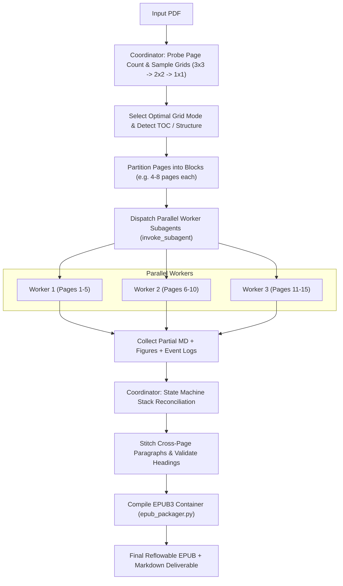

# PDF to EPUB Converter Skill

An **agentic, vision-first skill** where the **LLM guides the entire conversion process** through intelligent Document Layout Analysis (DLA), dynamic chunk-by-chunk decision making, and tool calling.
This is **NOT a monolithic script or external vision API client**—the LLM itself performs reconnaissance, decides the appropriate extraction strategy for each chunk, calls tools (`collage_maker.py`, `view_file`, `invoke_subagent`, `ask_question`), and directly writes the EPUB3 ebook.

---

## Core Architecture & Principles

1. **LLM as the Conversion Orchestrator**:
   - The LLM does not delegate blindly to a rigid black-box script.
   - The LLM guides the workflow: performs DLA, inspects visual collages via `view_file`, breaks the document into logical chunks, and dynamically selects the best tool calls for each chunk.
2. **Chunk-by-Chunk Decision & Tool Calling Loop**:
   For **each page block / chunk**, the LLM inspects the layout and decides:
   - **Scanned Text (Non-Digital / Degraded Image Pages)**:
     - The LLM **MUST ASK THE USER** via `ask_question`:
       - Option 1: `(Recommended) Use LLM Vision tools with Collage Grids (Saves tokens by grouping 2x2/3x3 pages per view)`
       - Option 2: `Use LLM Vision tools (Single-page 1x1 high resolution)`
       - Option 3: `Use Tesseract OCR (Fast local CLI processing)`
     - **Collage to Save Tokens**: During the scanning/OCR process, the LLM and subagents **may collage pages (e.g. 2x2 or 3x3 grids via `collage_maker.py collage`) if the user permits to save tokens** and reduce subagent roundtrips, provided legibility is maintained.
     - If user selects Vision tools: The LLM invokes a subagent (`invoke_subagent`), which calls `view_file` on the page image/collage to read and transcribe with its native multimodal vision ability.
     - If user selects Tesseract: The LLM runs local Tesseract OCR via `run_command`.
   - **Handwritten Content**:
     - If a chunk contains handwritten notes, equations, whiteboard diagrams, or margin sketches:
     - The LLM **MUST use its vision tools for the crop**:
       - Tool call `collage_maker.py crop <pdf> --page <P> --coords "<ymin,xmin,ymax,xmax>" -o figures/handwritten_p<P>_<N>.png`.
       - Tool call `view_file` (or invoke a vision subagent) to view the cropped image and transcribe the handwriting accurately into LaTeX math `$..$` / `$$..$$`, or embed the high-res crop as a clean figure.
   - **Digital Text & Tables**:
     - Extracts text flow, resolves columns, de-hyphenates line wraps, formats Markdown tables.
   - **Diagrams & Vector Graphics**:
     - Tool call `collage_maker.py crop` to extract PNG figures into `figures/`.
3. **Direct EPUB3 Writing (Zero Intermediate LaTeX Staging)**:
   - When converting from PDF to EPUB, **NEVER** use an intermediate `PDF -> LaTeX (.tex) -> EPUB` compilation stage (e.g. generating `.tex` documents or invoking `tex4ebook`/`make4ht`).
   - Directly extract layout, semantic text, tables, and cropped figures into reflowable Markdown/XHTML, convert math notation directly into native W3C MathML, and package directly into valid EPUB3 via `epub_packager.py`.
4. **Adaptive Visual Grid Sampling (Collage Probing)**:
   - Probes page density starting with **3x3** (9 pages/view) -> **3x2** (6 widescreen 16:9 slides/view) -> **2x2** (4 pages/view) -> **1x1** (single-page high resolution).
   - **3x2 Widescreen Grid (Optimal for Slide Decks)**:
     - Arranges 6 widescreen (16:9) slides 3 columns across by 2 rows down ($48:18$ / $8:3$ aspect ratio).
     - Because lecture presentation fonts are large (20–36pt), rendering at 120–140 DPI preserves 100% legibility of all mathematical sub/superscripts and matrix entries while saving 33% on token costs and subagent roundtrips compared to 2x2.
     - **Slide Unhiding**: Automatically unhides slides marked `show="0"` before headless LibreOffice export, guaranteeing strict 1:1 slide-to-page alignment with zero drift.
   - Determines the highest page density that allows 100% reliable text, diagram, and equation reading.
5. **Hierarchical Range Partitioning with Parallel Subagents**:
   - The **Coordinator Agent** probes resolution, scans the Table of Contents (TOC), partitions the document into balanced page blocks, and dispatches parallel worker subagents using `invoke_subagent`.
   - **Worker Subagents** process their assigned page blocks concurrently using their native multimodal vision capabilities.
6. **Hybrid Math & Visual Asset Strategy**:
   - **Direct MathML**: Transcribes clean inline (`$...$`) and display (`$$...$$`) math formulas in standard notation, compiled directly into native W3C MathML (`<math>`) for reflowable e-reader typography (zero `.tex` document compiling).
   - **Visual Fallback**: Crops high-resolution images (`[ymin, xmin, ymax, xmax]`) for complex chemical diagrams, commutative diagrams, intricate charts, and dense figures.
7. **Structured Header Event Log & State Machine Stack**:
   - Workers emit Markdown along with structured event tags for headings, container openings/closings, and cross-page paragraph cuts.
   - Coordinator reconciles the global hierarchy stack, stitches split sentences across page boundaries, and generates the EPUB Table of Contents.

---

## Bundled Resources & Directory Structure

The skill follows standard progressive disclosure across three layers:
- `scripts/`: Executable code for deterministic & repetitive conversion tasks:
  - `novel_crawler.py`: Web novel crawler, multi-tier ad/watermark cleaner, DevTools console script generator, and EPUB3 packager.
  - `html_to_epub.py`: Direct HTML / XHTML / Web Page to EPUB3 converter (Native MathML, asset bundling, article cleaning).
  - `tex_to_epub.py`: Direct LaTeX / TeX to EPUB3 converter (Native W3C MathML equations, PDF figure transcoding).
  - `docx_to_epub.py`: Direct DOCX to EPUB3 converter (Zero intermediate PDF, automatic font bloat sanitization).
  - `docx_to_pdf.py`: Direct DOCX / Word to PDF converter with sandboxed profile isolation.
  - `pptx_parser.py`: Direct PowerPoint (PPTX / PPT) to Markdown & EPUB3 extraction engine with DLA.
  - `collage_maker.py`: Adaptive visual grid collage generator and region cropper (supports PDF, PPTX, PPT with 3x2, 2x2, 3x3).
  - `epub_packager.py`: Self-contained EPUB3 compiler with native W3C MathML and single/multi-flow layout.
  - `verify_fidelity.py`: Line-by-line quality and fidelity verifier with sentence alignment coverage.
  - `compare_with_gold.py`: Verification tool comparing generated EPUBs against reference gold standards.
  - `cli.py`: Unified command-line interface (`pdf-to-epub`).
- `references/`: Detailed specifications loaded into agent context on demand:
  - `references/crawler_rules.md`: Algorithmic DOM density scoring, recipe schemas, and DevTools script instructions.
  - `references/mathml_standards.md`: W3C MathML namespace, OPF properties, and LaTeX translation rules.
  - `references/dla_architecture.md`: Visual collage grid sampling (3x3/2x2/3x2), heading stack state machines, and margin purging.
- `assets/`: Templates and starter configurations:
  - `assets/styles/epub_default.css`: Clean, dark-mode-ready EPUB3 typography stylesheet.
  - `assets/styles/mathml.css`: Mathematical formula layout styles.
  - `assets/site_recipes/template_recipe.json`: Starter recipe for web novel domains.

### 1. `docx_to_epub.py` (Direct Word to EPUB3 — No PDF In Between)
```bash
# Convert DOCX directly to clean EPUB3 (single-flow matching Google Docs gold layout)
python3 ~/.gemini/config/skills/pdf-to-epub/scripts/docx_to_epub.py document.docx -o document.epub

# Convert with chapter splits by heading
python3 ~/.gemini/config/skills/pdf-to-epub/scripts/docx_to_epub.py document.docx -o document.epub --flow split

# Via unified CLI
python3 ~/.gemini/config/skills/pdf-to-epub/scripts/cli.py docx2epub document.docx -o document.epub
python3 ~/.gemini/config/skills/pdf-to-epub/scripts/cli.py convert document.docx -o document.epub

# Batch convert a folder of DOCX files directly to EPUB3
python3 ~/.gemini/config/skills/pdf-to-epub/scripts/docx_to_epub.py docs_folder/ --outdir epubs/

# Verify parity with gold standard reference EPUB
python3 ~/.gemini/config/skills/pdf-to-epub/scripts/compare_with_gold.py
```
- **Zero Intermediate PDF**: Bypasses PDF generation entirely, preserving true semantic reflow, inline code tables, lists, and embedded images directly from Word XML.
- **100% Gold Reference Parity**: Achieves 100.00% core body text match, exact image match (e.g. 82/82 in Lab 3), and identical table counts compared to Google Docs exported gold EPUBs.
- **Semantic Structure Enrichment**: Automatically detects Heading 1–6 and Title styles from `word/document.xml` and injects semantic `<h1>`–`<h6>` tags and `<p class="title">` headers.
- **Flow Architecture (`--flow single|split`)**: Defaults to `single` for 1:1 parity with Google Docs single-flow XHTML layout, or `split` for individual chapter section files.
- **Automatic Font Bloat Sanitization**: Strips 40MB+ of embedded system fonts (`OEBPS/fonts/*.otf`) that LibreOffice injects by default, shrinking bloated 32MB EPUBs down to ~500KB (identical to Google Docs export).
- **Dual Engine Architecture**: Defaults to LibreOffice headless with auto-sanitization and semantic enrichment, falling back to pure-Python semantic parsing (`mammoth` + `epub_packager.py`).

### 2. `tex_to_epub.py` (Direct LaTeX / TeX to EPUB3 with Native MathML)
```bash
# Convert TeX document directly to EPUB3 with native W3C MathML equations
python3 ~/.gemini/config/skills/pdf-to-epub/scripts/tex_to_epub.py paper.tex -o paper.epub

# Convert with single-flow continuous document layout
python3 ~/.gemini/config/skills/pdf-to-epub/scripts/tex_to_epub.py paper.tex -o paper.epub --flow single

# Via unified CLI
python3 ~/.gemini/config/skills/pdf-to-epub/scripts/cli.py tex2epub paper.tex -o paper.epub
python3 ~/.gemini/config/skills/pdf-to-epub/scripts/cli.py convert paper.tex -o paper.epub

# Batch convert a folder of .tex files directly to EPUB3
python3 ~/.gemini/config/skills/pdf-to-epub/scripts/tex_to_epub.py papers_folder/ --outdir epubs/
```
- **Native W3C MathML**: Automatically compiles inline math (`$...$`), display equations (`$$...$$`, `\begin{equation}`), matrices, and Greek notation into standard, reflowable MathML (`<math>`) tags.
- **Sandboxed Compilation**: Build directories (`-B <dir>`, `-d <dir>`) are isolated in temporary workspaces; auxiliary files (`.aux`, `.log`, `.idv`, `.4ct`) never pollute the source directory.
- **PDF Figure Auto-Transcoding**: Detects `\includegraphics{...pdf}` and automatically converts vector PDF graphics into high-resolution PNGs with `pdftoppm` for strict EPUB3 compliance.
- **Auto-Preamble Injection**: Automatically detects raw TeX snippets or lecture notes missing `\documentclass` and wraps them in an `amsmath`, `amssymb`, `graphicx`, `hyperref` preamble.
- **Dual Engine Architecture**: Defaults to `tex4ebook` (TeX Live standard), falling back to `make4ht` + `epub_packager.py`.

### 3. `html_to_epub.py` (Direct HTML / XHTML / Web Page to EPUB3)
```bash
# Convert a single HTML file to clean EPUB3
python3 ~/.gemini/config/skills/pdf-to-epub/scripts/html_to_epub.py article.html -o article.epub

# Convert with article cleaning (removes ad scripts, tracking pixels, navigation chrome)
python3 ~/.gemini/config/skills/pdf-to-epub/scripts/html_to_epub.py web_page.html -o article.epub --clean-article

# Convert and merge multi-file documentation / book chapters into one EPUB
python3 ~/.gemini/config/skills/pdf-to-epub/scripts/html_to_epub.py chapter1.html chapter2.html -o book.epub --title "My Book"

# Convert an online web article directly from URL
python3 ~/.gemini/config/skills/pdf-to-epub/scripts/html_to_epub.py https://example.com/article -o web_article.epub

# Via unified CLI
python3 ~/.gemini/config/skills/pdf-to-epub/scripts/cli.py html2epub article.html -o article.epub
python3 ~/.gemini/config/skills/pdf-to-epub/scripts/cli.py convert article.html -o article.epub
```
- **Universal Input Ingestion**: Converts standalone HTML/XHTML files, web articles from HTTP/HTTPS URLs, multi-page HTML documentation, or entire directories of chapter files.
- **Intelligent Asset Harvesting**: Inlines and decodes base64 data URIs into standalone PNG/JPEG assets, resolves and bundles local relative images/SVGs, and downloads remote images.
- **Article Cleaning (`--clean-article`)**: Purges web ads, tracking scripts, iframes, navigation menus, and cookie notices while preserving semantic body text, code blocks, tables, blockquotes, and figures.
- **Native W3C MathML & Code Blocks**: Preserves `<math>` formulas and formats `<pre><code>` blocks with clean monospace typography.
- **Multi-File Chapter Merging**: Merges an ordered sequence of HTML files into a structured multi-chapter book with an auto-generated Table of Contents (`nav.xhtml` & `toc.ncx`).

### 4. `novel_crawler.py` (Web Novel Crawler, Sanitizer & EPUB3 Builder)
```bash
# 1. Probe site structure (discovers content placeholder, ad blocks, and TOC links)
python3 ~/.gemini/config/skills/pdf-to-epub/scripts/novel_crawler.py probe https://site.com/novel/toc

# 2. Pilot Crawl (verifies first 5 chapters before full crawl)
python3 ~/.gemini/config/skills/pdf-to-epub/scripts/novel_crawler.py crawl https://site.com/novel/toc \
    --engine http --pilot 5 -o novel.epub

# 3. Full Crawl (resumable, polite delay, multi-tier ad stripping)
python3 ~/.gemini/config/skills/pdf-to-epub/scripts/novel_crawler.py crawl https://site.com/novel/toc \
    --engine http --delay 1.5 -o complete_novel.epub

# 4. Generate DevTools Console Script (paste in browser console to bypass Cloudflare/Paywalls)
python3 ~/.gemini/config/skills/pdf-to-epub/scripts/novel_crawler.py console-script https://site.com/novel/ch1

# 5. Import Browser-Downloaded ZIP directly into EPUB3
python3 ~/.gemini/config/skills/pdf-to-epub/scripts/novel_crawler.py import-zip novel_chapters.zip -o novel.epub

# Via unified CLI
python3 ~/.gemini/config/skills/pdf-to-epub/scripts/cli.py crawl2epub https://site.com/novel/toc -o novel.epub
python3 ~/.gemini/config/skills/pdf-to-epub/scripts/cli.py convert novel_chapters.zip -o novel.epub
```
- **No-LLM Algorithmic Scorer**: Discovers chapter content placeholders automatically via DOM text-to-link density profiling (`(p_count * 50 + text_len) * (1 - link_ratio)`), requiring zero LLM tokens.
- **Multi-Tier Ad & Noise Sanitizer**: Eliminates structural CSS ad selectors, strips hidden anti-scraper text (`display:none`, `opacity:0`), cleans regex watermarks, and flags repeated cross-chapter boilerplates.
- **Multi-Engine Execution**:
  - `http`: Fast, lightweight `urllib` client with realistic browser headers, cookies, and exponential backoff retry.
  - `playwright`: Headless Chromium browser for JavaScript-heavy or single-page applications.
  - `console`: Standalone JavaScript script that runs directly in the user's browser DevTools, extracts chapters, and downloads a `.zip`.
- **Structured Workspace & Cache (`.novel_cache/`)**:
  - `site_recipes/<domain>.json`: Reusable site boundary and selector definitions across novels.
  - `novels/<slug>/`: Resumable raw HTML and cleaned XHTML cache with `manifest.json`.
- **Pilot & Verification Diagnostics**: `--pilot N` runs an initial test batch, calculating average words per chapter and warning on suspicious blank or short chapters.

### 5. `docx_to_pdf.py` (Direct Word to PDF)
```bash
# Convert DOCX to high-fidelity vector PDF
python3 ~/.gemini/config/skills/pdf-to-epub/scripts/docx_to_pdf.py document.docx -o document.pdf --preview
```

### 6. `pptx_parser.py` (PowerPoint to EPUB3 & Markdown with DLA)
```bash
# Convert PPTX or legacy PPT directly into reflowable EPUB3 using DLA & Heading Stack
python3 ~/.gemini/config/skills/pdf-to-epub/scripts/pptx_parser.py presentation.pptx \
    -o presentation.epub \
    --title "Course Module Title" \
    --author "Professor Name"

# Extract presentation to Markdown with DLA manifest, purged footers/headers, and LaTeX equations
python3 ~/.gemini/config/skills/pdf-to-epub/scripts/pptx_parser.py presentation.pptx \
    -o presentation.md \
    --figures figures/ \
    --manifest dla_manifest.json \
    --transcriptions transcriptions.json
```
- **Document Layout Analysis (DLA)**: Intelligently classifies shapes into text, tables, diagram figures, and equation blocks.
- **Repetitive Header & Footer Purging**: Scans margin regions (top 15%, bottom 15%) across slides and removes repeating institutional text, professor names, course codes, and slide numbers.
- **Heading Stack State Machine**: Thematically clusters continuation slides into coherent textbook chapters (H1 -> H2 -> continuations), preventing artificial 1-slide page breaks and tiny 2-sentence chapters.
- **Multimodal Vision Routing**: Routes complex mathematical formulas and text graphics to Vision LLMs for LaTeX MathML transcription, while embedding diagrams/illustrations as-is. Replaces noisy pytesseract OCR.

### 7. `collage_maker.py`
```bash
# 1. Get total page/slide count
python3 ~/.gemini/config/skills/pdf-to-epub/scripts/collage_maker.py count document.pdf

# 2. Render visual collage grid (3x2 for slides, 3x3 or 2x2 for books/papers)
python3 ~/.gemini/config/skills/pdf-to-epub/scripts/collage_maker.py collage presentation.pptx \
    --start 1 --end 6 --grid 3x2 -o /tmp/probe_3x2.png --dpi 140

# 3. Crop figure/equation bounding box from high-res page (coords: ymin,xmin,ymax,xmax in 0-1000 or 0.0-1.0)
python3 ~/.gemini/config/skills/pdf-to-epub/scripts/collage_maker.py crop document.pdf \
    --page 3 --coords "150,200,450,850" -o figures/fig_p3_1.png --dpi 300
```

### 8. `epub_packager.py`
```bash
# Compile Markdown + cropped figures into valid EPUB3
python3 ~/.gemini/config/skills/pdf-to-epub/scripts/epub_packager.py document.md \
    -o book.epub \
    --figures figures/ \
    --title "Document Title" \
    --author "Author Name" \
    --lang en \
    --split-mode auto
```

### 9. `verify_fidelity.py` (Line-by-Line Quality & Fidelity Verifier)
```bash
# Run line-by-line verification after each build (supports PDF, PPTX, and PPT)
python3 ~/.gemini/config/skills/pdf-to-epub/scripts/verify_fidelity.py \
    --source presentation.pptx \
    --epub presentation.epub \
    --threshold 95.0 \
    --verbose
```

---


## End-to-End Execution Protocol



> [!IMPORTANT]
> **Zero Intermediate LaTeX**: When converting from PDF to EPUB, never stage through an intermediate `.tex` document or invoke TeX compilers (`tex4ebook`, `make4ht`, `pdflatex`). Directly write and package the EPUB file using `epub_packager.py`.

### Stage 1: Document Reconnaissance & Grid Probing

1. **Inspect Page Count**:
   Run `collage_maker.py count <pdf_path>` to determine the total number of pages.
2. **Adaptive Grid Probing**:
   - Render a probe collage of pages 1–4 using `3x3` grid mode to `/tmp/probe_grid.png`.
   - Inspect the image. Evaluate:
     - Are body text fonts crisp and fully legible?
     - Are inline mathematical symbols (`\alpha`, `\sum`, sub/superscripts) unambiguously distinguishable?
     - If text is too small or multi-column layout is dense, test `2x2`.
     - If font is tiny, scanned, or complex, adopt `1x1` single-page rendering.
3. **Detect Table of Contents & Major Divisions**:
   - Check pages 1–5 for an explicit Table of Contents or chapter listing.
   - Note major structural divisions to guide block partitioning.
4. **Scanned Text & OCR Engine Selection (User Choice)**:
   - Check if pages are scanned raster images without digital text.
   - If scanned text is detected, **MUST ASK THE USER** via `ask_question`:
     - Option 1: `(Recommended) Use LLM Vision tools with Collage Grids (Saves tokens by grouping 2x2/3x3 pages per view)`
     - Option 2: `Use LLM Vision tools (Single-page 1x1 high resolution)`
     - Option 3: `Use Tesseract OCR (Fast local CLI processing)`
   - **Collage Token Optimization**: If the user permits, workers may generate 2x2 or 3x3 collages during vision OCR to significantly cut vision token costs and subagent roundtrips.
5. **Handwritten Content Detection**:
   - Inspect probe collages for handwritten text, formulas, or annotations.
   - Flag any handwritten regions so workers know they **must use LLM vision tools for the crop**.

---

### Stage 2: Page Partitioning & Subagent Dispatch

Partition the PDF into contiguous page chunks. 
- **Standard Books / Novels**: 8–12 pages per chunk.
- **Academic / Math / 2-Column Papers**: 3–5 pages per chunk.

Call `invoke_subagent` to launch parallel workers. Example:
```python
invoke_subagent(
    Subagents=[
        {
            "TypeName": "self",
            "Role": "PDF Worker Batch 1",
            "Prompt": worker_prompt(start=1, end=5, grid="2x2", ...)
        },
        {
            "TypeName": "self",
            "Role": "PDF Worker Batch 2",
            "Prompt": worker_prompt(start=6, end=10, grid="2x2", ...)
        }
    ]
)
```

---

### Stage 3: Worker Subagent Execution Protocol

Each worker follows this strict workflow:

1. **Render Grid Collages for Assigned Range**:
   Run `collage_maker.py collage <pdf_path> --start <S> --end <E> --grid <GRID> -o <chunk_img>`.
2. **Multimodal Analysis & Reading Flow**:
   - Identify multi-column flow (read left column top-to-bottom, then right column).
   - Strip running headers, footers, and floating page numbers.
   - De-hyphenate line-wrapped words (e.g. `distri-` + `buted` -> `distributed`), but preserve real compound words.
3. **Hybrid Math & Figure Extraction (Mandatory Vision Crop for Handwriting)**:
   - **Handwritten text & equations**: **MUST use LLM vision tools for the crop**. Locate bounding box `[ymin, xmin, ymax, xmax]`, run `collage_maker.py crop <pdf> --page <P> --coords "<coords>" -o "figures/fig_handwritten_p<P>_<N>.png"`, and transcribe using Multimodal LLM Vision or embed as a clean figure.
   - Standard formulas: write as LaTeX (`$...$` or `$$...$$`) for direct MathML rendering.
   - Diagrams, charts, plots, complex architecture diagrams:
     - Determine bounding box `[ymin, xmin, ymax, xmax]` (0–1000 scale).
     - Run `collage_maker.py crop <pdf> --page <P> --coords "<coords>" -o "figures/fig_p<P>_<N>.png"`.
     - Insert markdown reference: ``.
4. **Structured Event Logging**:
   At the beginning or end of its generated Markdown, the worker records its structural events in a JSON metadata block:
   ```json
   ```events
   [
     {"type": "heading", "level": 1, "title": "1. Introduction", "page": 1},
     {"type": "heading", "level": 2, "title": "1.1 Background", "page": 2},
     {"type": "split_out", "ends_with_open_sentence": true, "last_words": "resulting in higher throughput"}
   ]
   ```
   ```

---

### Stage 4: Coordinator Hierarchy Stack & Assembly

The Coordinator receives completed outputs from all subagents and reconciles them:

1. **State-Machine Hierarchy Stack**:
   - Maintain a stack of active heading levels: `[H1, H2, ...]`.
   - If a worker outputs an `H3` under an `H1` without an `H2`, normalize or nest appropriately.
   - Build a clean Table of Contents tree.
2. **Seamless Cross-Page Paragraph Stitching**:
   - If Worker `N` ended with `ends_with_open_sentence: true` and Worker `N+1` began without a heading or indent, concatenate the paragraphs without an artificial line break.
3. **Consolidate Figures**:
   - Verify that all referenced `figures/*.png` files exist on disk.
4. **Write Unified Markdown**:
   - Assemble the unified document into `output.md`.

---

### Stage 5: EPUB3 Packaging & Verification

1. **Compile EPUB**:
   Run the packager script:
   ```bash
   python3 ~/.gemini/config/skills/pdf-to-epub/scripts/epub_packager.py output.md \
       -o output.epub \
       --figures figures/ \
       --title "<Book Title>" \
       --author "<Author Name>"
   ```
2. **Quality & Structure Validation**:
   - Check that `mimetype` is uncompressed at offset 0 (`unzip -l output.epub`).
   - Verify `EPUB/nav.xhtml` contains all detected chapters.
   - Check that figures and math equations are cleanly formatted.

---

## Detailed Worker Prompt Template

When invoking subagents, format their prompt using this template:

```markdown
You are a PDF-to-EPUB conversion worker responsible for Pages {START} to {END} of {PDF_PATH}.

### Tasks:
1. Render your pages using the agreed grid resolution:
   python3 ~/.gemini/config/skills/pdf-to-epub/scripts/collage_maker.py collage "{PDF_PATH}" --start {START} --end {END} --grid {GRID} -o "/tmp/batch_{START}_{END}.png" --dpi 140

2. View the generated collage image using `view_file` tool to inspect the content with your native multimodal vision ability. Read all text in natural reading order (handle multi-column layout properly).
   - If pages are scanned text: Use your multimodal vision to transcribe all body text, headings, and tables accurately into Markdown.
   - If content is handwritten: MUST use vision tools for the crop: locate bounding box `[ymin, xmin, ymax, xmax]`, run:
     python3 ~/.gemini/config/skills/pdf-to-epub/scripts/collage_maker.py crop "{PDF_PATH}" --page <P> --coords "ymin,xmin,ymax,xmax" -o "figures/fig_handwritten_p<P>_<N>.png"
     Then view the cropped image with `view_file` and transcribe into LaTeX math ($...$ or $$...$$) or embed as a clean figure.
   - Strip headers, footers, and page numbers.
   - Format standard formulas as LaTeX: $...$ for inline, $$...$$ for display blocks.
   - For all figures, plots, diagrams, or dense equations, crop them using:
     python3 ~/.gemini/config/skills/pdf-to-epub/scripts/collage_maker.py crop "{PDF_PATH}" --page <P> --coords "ymin,xmin,ymax,xmax" -o "figures/fig_p<P>_<N>.png"
     And reference them as: 

3. Format tables using clean Markdown table syntax (| Col 1 | Col 2 |).

4. Save your section's Markdown to: "/tmp/section_{START}_{END}.md"
   Include your structural event log at the very end in a ```events ... ``` block:
   [
     {"type": "heading", "level": <1-6>, "title": "<Heading Title>", "page": <P>},
     {"type": "split_out", "ends_with_open_sentence": <true/false>, "last_words": "..."}
   ]

Report when finished with the word count and figure count extracted.
```

---

## Key Heuristics & Edge Cases

| Scenario | Recommended Treatment |
| :--- | :--- |
| **Document Layout Analysis (DLA)** | Use YOLO DLA (`Armaggheddon/yolo26-document-layout` via `ultralytics` / `huggingface_hub`) to classify `Picture`, `Caption`, `Formula`, `Page-footer`, and `Section-header` bounds. Run on `device='cpu'` by default unless verified CUDA CC >= 7.5. |
| **Safe Figure Cropping Margins** | When cropping vector diagrams or charts, add a +10-15px margin to prevent slicing rounded boundary borders or bottom axis/variable labels (e.g. `input: x`, `x(t)`). Ensure the crop cuts off strictly before the caption text. |
| **Caption Deduplication** | `epub_packager.py` transforms `` directly into `<figure><figcaption>Caption Text</figcaption></figure>`. **Never** append a redundant markdown line `*Figure X...*` below the image tag, which causes duplicate captions in e-readers. |
| **Academic 2-Column Layout** | Read column 1 from top to bottom before reading column 2. Do not interleave lines horizontally. |
| **Spanning Titles / Figures** | Elements spanning both columns break the 2-column flow. Place them as full-width blocks between column sections. |
| **Running Headers & Watermarks** | Strip conference running headers (IEEE, AAAI, ACM) and digital library download watermarks (e.g., `Authorized licensed use limited to: ... Restrictions apply.`) so they do not pollute the reflowable text. |
| **Line-End Hyphens** | If a line ends with `word-` and the next starts with `fragment`, check if it is a compound word (e.g. `state-of-the-art`) vs a word broken by margin (e.g. `trans-portation`). Join broken words as `transportation`. |
| **Inline & Display Math** | Preserve Greek letters (`\alpha`, `\beta`), summation (`\sum`), subscripts (`x_i`), and fractions (`\frac{a}{b}`) using LaTeX syntax ($...$ or $$...$$). The packager transforms these into accessible, native MathML `<math>`. |
| **Continuous Single-Flow Mode** | For papers and short monographs, pass `split_mode="single"` to `epub_packager.py` to prevent arbitrary screen-clearing page breaks between sections. |
| **Post-Turn Verification** | Always run `python3 scripts/verify_fidelity.py --pdf input.pdf --epub output.epub --threshold 95.0` to verify container integrity, MathML rendering, and line-by-line sentence coverage before concluding. |
