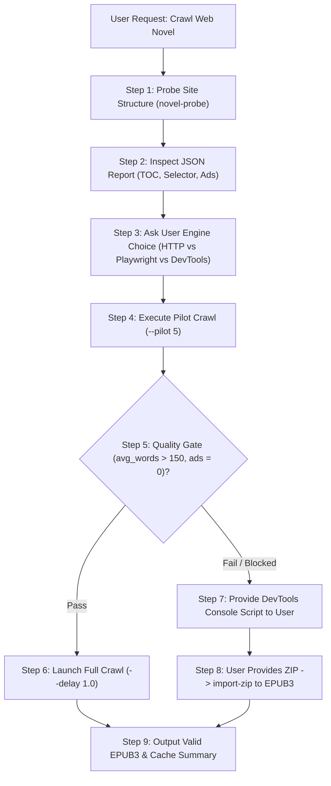

# PDF-to-EPUB: Complete Tool & CLI Usage Manual

This document provides exhaustive usage details, command-line arguments, output structures, and autonomous LLM agent execution protocols for all tools in the `pdf-to-epub` suite.

---

## Table of Contents

- [Unified CLI Overview](#unified-cli-overview)
- [Web Novel Crawler (`novel_crawler.py` / `crawl2epub`)](#web-novel-crawler-novel_crawlerpy--crawl2epub)
  - [Command Reference](#command-reference)
  - [Full Autonomous LLM Protocol](#full-autonomous-llm-protocol)
  - [DevTools Browser Exporter (Bypass Cloudflare / Paywalls)](#devtools-browser-exporter-bypass-cloudflare--paywalls)
- [Word Documents (`docx_to_epub.py` / `docx2epub`)](#word-documents-docx_to_epubpy--docx2epub)
- [LaTeX / TeX Documents (`tex_to_epub.py` / `tex2epub`)](#latex--tex-documents-tex_to_epubpy--tex2epub)
- [PowerPoint Presentations (`pptx_parser.py` / `pptx`)](#powerpoint-presentations-pptx_parserpy--pptx)
- [HTML & Online Articles (`html_to_epub.py` / `html2epub`)](#html--online-articles-html_to_epubpy--html2epub)
- [Complex PDFs & Vision Probing (`collage_maker.py`)](#complex-pdfs--vision-probing-collage_makerpy)
  - [Adaptive Grid Probing](#adaptive-grid-probing)
  - [Bounding Box Cropping](#bounding-box-cropping)
  - [Packaging to EPUB3](#packaging-to-epub3)
- [Universal Auto-Detect Converter (`convert`)](#universal-auto-detect-converter-convert)
- [Quality Verification & Benchmarking (`verify_fidelity.py`)](#quality-verification--benchmarking-verify_fidelitypy)

---

## Unified CLI Overview

The suite provides a single executable `pdf-to-epub` (or `python3 scripts/cli.py`) with 16 dedicated subcommands:

```bash
pdf-to-epub --help
```

```text
usage: pdf-to-epub [-h]
                   {probe,count,collage,crop,package,verify,pptx,docx2pdf,docx2epub,
                    tex2epub,html2epub,convert,crawl2epub,novel-probe,
                    novel-console-script,novel-import-zip,install-skill} ...
```

---

## Web Novel Crawler (`novel_crawler.py` / `crawl2epub`)

High-performance crawler designed for serialized web fiction. Features no-LLM DOM text-to-link density scoring, multi-tier ad stripping, polite delays, and resumable caching in `.novel_cache/`.

### Command Reference

```bash
# 1. Probe site structure (discovers TOC links, content selector, ad blocks)
pdf-to-epub novel-probe https://novel-site.com/book/toc

# 2. Pilot crawl (downloads & audits first 5 chapters before full crawl)
pdf-to-epub crawl2epub https://novel-site.com/book/toc --pilot 5 -o sample.epub

# 3. Full crawl with polite delay (HTTP client - fast & zero overhead)
pdf-to-epub crawl2epub https://novel-site.com/book/toc --engine http --delay 1.2 -o novel.epub

# 4. Headless browser crawl (for heavy React / Vue / SPA novel sites)
pdf-to-epub crawl2epub https://novel-site.com/book/toc --engine playwright -o novel.epub

# 5. Generate browser DevTools console extraction script
pdf-to-epub novel-console-script https://novel-site.com/book/ch1 -o export.js

# 6. Import browser-downloaded ZIP into EPUB3
pdf-to-epub novel-import-zip novel_chapters.zip -o novel.epub

# 7. Audit cached chapters for blank content or short-chapter traps
python3 scripts/novel_crawler.py verify https://novel-site.com/book/toc
```

### Full Autonomous LLM Protocol

When an LLM agent receives a request to crawl a web novel, it must follow this deterministic 5-step sequence:



1. **Pre-Flight Probe**: Run `pdf-to-epub novel-probe <URL>` and inspect:
   - `is_toc_page`: If `true`, the URL is an index page containing chapter links.
   - `detected_content_selector`: The CSS selector of the main story container.
   - `has_next_chapter`: If `true`, sequential next-link traversal is supported.
2. **Engine Selection (Ask User First)**:
   - Offer the user a clear choice between `[1] HTTP Client (Recommended)`, `[2] Playwright`, and `[3] DevTools Console Script`.
3. **Pilot Verification Gate**:
   - Run `pdf-to-epub crawl2epub <URL> --pilot 5 -o /tmp/pilot.epub`.
   - Verify that average words per chapter is $\ge 150$. If $<50$, investigate anti-bot walls or container selector mismatches.
4. **Full Crawl Execution**:
   - Maintain a minimum delay of `1.0s` to `2.0s` (`--delay 1.2`) to safeguard against IP rate limits.
   - Crawl progress is cached under `.novel_cache/novels/<slug>/`. Re-running automatically resumes where it left off.
5. **Anti-Bot / Cloudflare Fallback**:
   - If HTTP 403, 503, or Turnstile challenges occur, generate `novel-console-script <URL>` and instruct the user to run it in their browser console (F12) to download a `.zip`.

### DevTools Browser Exporter (Bypass Cloudflare / Paywalls)

1. Run:
   ```bash
   pdf-to-epub novel-console-script https://site.com/novel/ch1
   ```
2. Open Chapter 1 in Chrome/Firefox/Edge while logged in.
3. Open DevTools (**F12**), paste the generated script into the **Console**, and press **Enter**.
4. The script iterates through chapters in the authenticated browser session, cleans ads, and triggers a download of `<novel>_chapters.zip`.
5. Convert the ZIP to EPUB3:
   ```bash
   pdf-to-epub convert novel_chapters.zip -o novel.epub
   ```

---

## Word Documents (`docx_to_epub.py` / `docx2epub`)

Converts Word documents directly to reflowable EPUB3 with **zero intermediate PDF**, preserving semantic headings and stripping embedded system fonts.

```bash
# Convert DOCX directly to clean EPUB3 (single-flow matching Google Docs layout)
pdf-to-epub docx2epub document.docx -o book.epub

# Convert with chapter splitting by heading (H1)
pdf-to-epub docx2epub document.docx -o book.epub --flow split

# Batch convert a folder of DOCX files
pdf-to-epub docx2epub ./manuscripts/ -d ./output_epubs/

# Direct DOCX to vector PDF (with page 1 PNG preview)
pdf-to-epub docx2pdf document.docx -o document.pdf --preview
```

---

## LaTeX / TeX Documents (`tex_to_epub.py` / `tex2epub`)

Converts LaTeX documents directly to EPUB3 with native W3C MathML equations, vector figure transcoding, and sandboxed builds.

```bash
# Convert TeX document directly to EPUB3 (native MathML)
pdf-to-epub tex2epub paper.tex -o paper.epub

# Convert raw snippet or lecture notes (auto-injects amsmath/amssymb preamble)
pdf-to-epub tex2epub snippet.tex -o snippet.epub --flow single

# Disable MathML (rasterized math fallback)
pdf-to-epub tex2epub paper.tex -o paper.epub --no-mathml
```

---

## PowerPoint Presentations (`pptx_parser.py` / `pptx`)

Extracts lecture slides and presentation decks into structured EPUB3 textbooks and Markdown using Document Layout Analysis (DLA) and heading stack clustering.

```bash
# Convert slides into structured EPUB3 textbook
pdf-to-epub pptx lecture.pptx -o lecture.epub \
    --title "Machine Learning" \
    --author "Prof. Davis"

# Extract to clean Markdown with purged headers/footers and figure assets
pdf-to-epub pptx lecture.pptx -o lecture.md --figures figures/

# Disable heading stack (split every slide into its own page)
pdf-to-epub pptx lecture.pptx -o lecture.epub --no-heading-stack
```

---

## HTML & Online Articles (`html_to_epub.py` / `html2epub`)

Converts standalone HTML files or live URLs into clean EPUB3 ebooks with base64 image decoding, asset harvesting, and web ad sanitization.

```bash
# Convert an HTML file to EPUB3
pdf-to-epub html2epub article.html -o article.epub

# Clean web cruft (strips ads, scripts, nav bars, cookie banners)
pdf-to-epub html2epub article.html -o article.epub --clean-article

# Convert directly from a live web URL
pdf-to-epub html2epub https://example.com/deep-dive -o deep_dive.epub

# Merge multiple HTML files into a structured multi-chapter book
pdf-to-epub html2epub ch1.html ch2.html ch3.html -o book.epub --title "User Guide"
```

---

## Complex PDFs & Vision Probing (`collage_maker.py`)

For complex, multi-column, or scanned PDFs, the suite uses vision-first adaptive collage probing and parallel subagents.

> [!IMPORTANT]
> **Zero Intermediate LaTeX**: When converting from PDF to EPUB, never stage through an intermediate `.tex` document or invoke TeX compilers (`tex4ebook`, `make4ht`, `pdflatex`). Directly write and package the EPUB file using `epub_packager.py`.

### Adaptive Grid Probing

```bash
# 1. Count total pages
pdf-to-epub count paper.pdf

# 2. Render adaptive resolution probes (3x3, 2x2, 1x1)
pdf-to-epub probe paper.pdf -o ./probe_output/

# 3. Render 3x3 visual collage grid (Pages 1-9)
pdf-to-epub collage paper.pdf --start 1 --end 9 --grid 3x3 -o collage_3x3.png --dpi 120

# 4. Render 3x2 widescreen grid (Optimal for 16:9 slides)
pdf-to-epub collage slides.pdf --start 1 --end 6 --grid 3x2 -o collage_3x2.png --dpi 130
```

### Bounding Box Cropping

Crops diagrams, formulas, or figures using normalized coordinates `[ymin, xmin, ymax, xmax]` ($0–1000$ or $0.0–1.0$):

```bash
pdf-to-epub crop paper.pdf --page 3 --coords "180,120,440,880" -o figures/fig_p3_1.png --dpi 300
```

### Packaging to EPUB3

```bash
pdf-to-epub package document.md \
    -o book.epub \
    --figures figures/ \
    --title "Document Title" \
    --author "Author Name" \
    --lang en
```

---

## Universal Auto-Detect Converter (`convert`)

The `convert` command auto-routes any file or URL based on its extension or scheme:

```bash
pdf-to-epub convert input.docx -o output.epub
pdf-to-epub convert input.tex  -o output.epub
pdf-to-epub convert input.html -o output.epub
pdf-to-epub convert input.pptx -o output.epub
pdf-to-epub convert https://example.com/article -o output.epub
pdf-to-epub convert downloaded_novel.zip -o novel.epub
```

---

## Quality Verification & Benchmarking (`verify_fidelity.py`)

Performs line-by-line sentence alignment between the original source document and the generated EPUB:

```bash
pdf-to-epub verify --pdf original.pdf --epub generated.epub --threshold 95.0 --verbose
```

- **Pass Criterion**: Overall sentence coverage $\ge 95\%$.
- Generates JSON error reports identifying missing paragraphs, dropped captions, and hallucinated sections.
